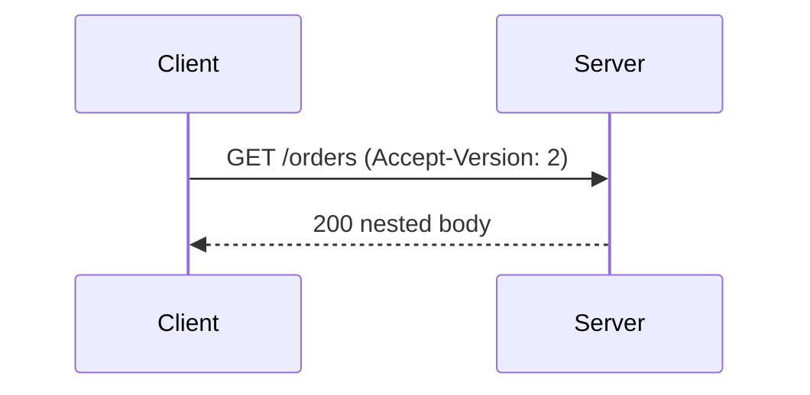

# Technical Diagrams

## Core principle

A diagram earns its place by showing a relationship the prose would make the reader reconstruct. If deleting it loses no relationship, keep the prose. What remains must be editable source, readable at its real size, and checkable without opening a drawing tool.

## Decision criteria

Pick the format from who edits it next:

| Format | Choose when | Refuse when |
| --- | --- | --- |
| Mermaid | The diagram is a flow, sequence, or state machine a reviewer will edit in text | The layout itself carries meaning the renderer may rearrange |
| SVG | Position, alignment, or containment is the point | The picture is a brand mark (`svg-logo-design`) or a slide (`visual-slide-deck`) |

SVG rules, checked on the source rather than on a screenshot:

- Set a `viewBox` and do not set fixed pixel `width` and `height`, so the drawing scales.
- Give the root `svg` a `<title>` and a `<desc>`. The title names the picture; the description states the relationship. They are not a substitute for visible labels.
- Use text for words. A label converted to paths or outlined cannot be searched, selected, or translated.
- Keep every text box inside the `viewBox`. Estimate width as `0.6em` per character and reject a run that crosses its box.
- Body text at least 14px, annotation text at least 12px, measured in user units. Smaller type is a failure even when the canvas is large.
- Contrast comes from `currentColor` for ink and one theme-neutral accent, both checked against WCAG 2.2 level AA at 4.5:1 for text. Do not hard-code a light-theme ink color that disappears on a dark page.
- No external images, scripts, or remote fonts. The file must render from its own bytes.

Mermaid rules: one diagram per fenced block, explicit participant names, and no styling that exists only to change color. Sequence diagrams number the message that the prose refers to.

Review the diagram by reading the source. A screenshot cannot show that text is real text or that the description exists.

## Workflow

1. Write the relationship in one sentence. Stop if the sentence is enough on its own.
2. Choose Mermaid or SVG with the table.
3. Draft the source inside the change, not in a separate binary.
4. Run the semantic checks: title, description, text elements, font floors, containment, contrast tokens, and no external references.
5. Read the title and description back and confirm they state the relationship, not "diagram".
6. Keep the figure beside the paragraph that uses it.

## Worked example

A client calls a server through a version header, and the point of the figure is which peer adds that header.



The SVG form of the same relationship is `examples/version-header.svg`. Its checks, all decided from the file:

| Check | Result |
| --- | --- |
| `viewBox` present, no fixed width or height | Pass |
| `<title>` and `<desc>` name the header direction | Pass |
| Both labels are `<text>`, 14px | Pass |
| Each label fits its box at 0.6em per character | Pass |
| Ink is `currentColor`; accent is one token | Pass |
| No `http:`, `https:`, `<script>`, or `<image>` | Pass |

The failing twin, `examples/version-header-broken.svg`, outlines the words as paths, uses 9px text, runs a label past the `viewBox`, hard-codes `#888` on white, and omits `<desc>`. Same boxes, fails the method.

From the package root:

```sh
node --test skills/technical-diagrams/examples/diagram-semantics.test.mjs
```

## Failure signals

- Text is converted to paths or outlined.
- A label crosses its box or the `viewBox`.
- Type is below 14px for body text or 12px for an annotation.
- Ink is a fixed light-theme color with no dark-theme alternative.
- The root has no `<title>` or no `<desc>`, or they say only "diagram".
- The file references a remote font, image, or script.
- A diagram restates one sentence the paragraph already says.

## Evaluation scenario

Given `examples/version-header.svg` and `examples/version-header-broken.svg`, the result should pass the first on title, description, real text, 14px type, containment, and contrast tokens, and fail the second on outlined text, 9px type, overflow, and missing description. It fails the method if both pass because both are well-formed XML.

## Output

- The relationship in one sentence
- Format choice and why
- Source file
- Semantic check results
- The paragraph the figure belongs to

## Boundary

This Skill never authorizes broader scope, branch integration, or orchestration control. Logos stay with `svg-logo-design` and slides with `visual-slide-deck`. It does not require a browser or a rendering service. Product direction, scope, and irreversible choices stay with the user.
